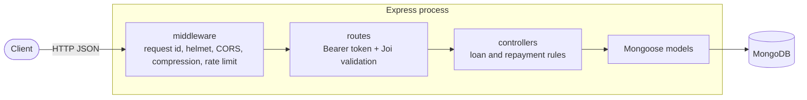

# nodejs-typescript-rest-boilerplate

One of three implementations of the same loan API: **Express + MongoDB** (this repo, the reference), [Fastify + PostgreSQL](https://github.com/the-vishal-kumar/fastify-postgres-boilerplate) and [Go + PostgreSQL](https://github.com/the-vishal-kumar/go-postgres-boilerplate). They share one contract and one conformance suite, both kept here, and are [measured side by side](./docs/comparison.md).

[](https://github.com/the-vishal-kumar/nodejs-typescript-rest-boilerplate/actions/workflows/ci.yml?query=branch%3Amain)


## Problem

Customers request a loan with an amount and a term in weeks. An admin approves it. The customer repays it in weekly instalments, in order, and the loan becomes `PAID` with the last one. ([Original brief](./PROBLEM.md).)

The rules are small but real:

- **Exact money.** Amounts have at most two decimals and are computed in integer cents. A schedule splits the amount into equal instalments with the remainder on the last one, so it always adds up (10000 over 3 is 3333.33, 3333.33, 3333.34).
- **Approval rules.** Only an admin approves, never their own loan, and never twice.
- **Ordered repayments.** A payment must cover the next instalment and may not exceed the balance; any surplus pays the following instalments.
- **Concurrency.** Two payments racing on one loan must never apply money twice or lose it.

## Design



- **Express 5** with async error forwarding: routes throw, one error handler builds the envelope.
- **Joi** validates params and bodies and converts input (numeric strings, trimmed and lower-cased email).
- **MongoDB through Mongoose 9.** Money is stored as `Decimal128` and computed in integer cents; public ids are UUIDs, never Mongo ids.
- **Repayment concurrency:** a standalone MongoDB has no multi-document transactions, so a payment first claims a short lease on the loan with a conditional update (`paymentLockedUntil`). Only one request holds it; a concurrent payment gets 409. The schedule is read after the claim and the lease is released when the writes are done. It expires on its own if a process dies holding it. Approval is also a conditional update.
- **Auth:** HS256 JWTs; the database stores only a SHA-256 of each token, so sign-off and password reset revoke sessions. Passwords use scrypt.
- **Operations:** `/health/live` never touches the database, `/health/ready` pings it and fails while shutting down. SIGTERM fails readiness, drains, closes MongoDB and exits 0. Configuration comes only from the environment and is validated at start-up, with every problem reported at once. Optional New Relic APM.

## Trade-offs of this stack

- **Flexible documents, weaker guarantees.** Loans and schedules are separate collections without transactions, so consistency is by design (write order, rollback on failure, a lease for payments) rather than by the database. The PostgreSQL versions get the same guarantee from a row lock in one transaction.
- **Mature middleware ecosystem.** Helmet, CORS, compression and rate limiting are one line each. The cost is more runtime dependencies than the other two.
- **Joi** gives readable messages and conversion with little code, but no static types: handlers trust that validation ran.
- **Single-process rate limits.** Limits are kept in memory, per process. Several replicas need a shared store such as Redis.

## Comparison summary

Measured on one machine on 2026-11-13 with the shared k6 mix (20 users, API limited to 2 CPUs and 512 MiB, median of three 60 s runs). Method, all rows and the reasoning behind them: [docs/comparison.md](./docs/comparison.md).

| Measure | Express + MongoDB | Fastify + PostgreSQL | Go + PostgreSQL |
|---|---:|---:|---:|
| Throughput (requests/s) | 125.6 | 172.5 | 182.5 |
| Sign-in p50 / p99 (ms) | 214 / 406 | 595 / 777 | 172 / 478 |
| Get loan p50 / p99 (ms) | 110 / 213 | 2.6 / 62.6 | 74.7 / 205 |
| Repayment p50 / p99 (ms) | 189 / 311 | 6.9 / 71.4 | 89.3 / 239 |
| RSS at rest (MiB) | 82.1 | 77.7 | 12.6 |
| RSS under load, peak (MiB) | 245.1 | 256.0 | 338.6 |
| Image size (MB) | 469.7 | 371.5 | 37.5 |
| Cold start to ready (ms) | 814 | 1285 | 958 |
| Lines of code, excluding tests | 1513 | 1055 | 2157 |
| Runtime dependencies, direct / total | 12 / 298 | 6 / 69 | 3 / 8 |

In short: Fastify answers ordinary requests fastest; Go has the highest throughput and by far the smallest image and idle memory, but the highest peak memory; this Express version is the slowest under load and has the most dependencies. The comparison explains each result, including the losses.

## Quick start (Docker only)

```bash
git clone https://github.com/the-vishal-kumar/nodejs-typescript-rest-boilerplate.git
cd nodejs-typescript-rest-boilerplate
make up        # API and MongoDB on http://localhost:3000, docs at /docs
make down
```

Every target runs in containers; the host needs only Docker and make.

| Target | What it does |
|---|---|
| `make lint` | Prettier check and ESLint |
| `make typecheck` | `tsc --noEmit` |
| `make build` | Compile to `build/` |
| `make test` | Unit and e2e tests (Jest, in-process) against a throwaway MongoDB |
| `make contract` | Export the OpenAPI document to `contract/openapi.json` |
| `make conformance` | Fresh stack plus the shared conformance suite |
| `make image` / `make scan` | Production image; Trivy scan for fixable HIGH/CRITICAL CVEs |
| `make bench` | The shared k6 load test (see below) |

Configuration lives in [`.env.sample`](./.env.sample); `make up` copies it to `.env` on first run. A [Postman collection](./Postman) is included.

## Contract, conformance suite and benchmark

- [`contract/openapi.json`](./contract/openapi.json) is the API contract, exported from [`src/docs/openapi.ts`](./src/docs/openapi.ts) with `make contract`. The e2e suite fails if the served document and the file differ. The other implementations serve the same document with only the title and description changed.
- [`conformance/`](./conformance) is a black-box suite (Node 22 `node:test` and `fetch`, no dependencies) that checks the behaviour over HTTP. `make conformance` starts a fresh stack and runs it. The other implementations run the same files, pinned by the `conformance-v2` tag.
- [`conformance/load/`](./conformance/load) holds the k6 load mix and the benchmark script behind `make bench`, which runs under the CPU and memory limits in [`compose.bench.yaml`](./compose.bench.yaml). The results are in [docs/comparison.md](./docs/comparison.md).

## CI

[`.github/workflows/ci.yml`](./.github/workflows/ci.yml), actions pinned by commit SHA:

1. Production dependency audit, Prettier, ESLint, type-check and build, Jest unit and e2e tests against a MongoDB service, with the coverage report as an artifact.
1. Image build, compose up, the conformance suite, a smoke test, a check that SIGTERM exits 0, and a Trivy scan.

## License

[MIT](./LICENSE), Vishal Kumar.
